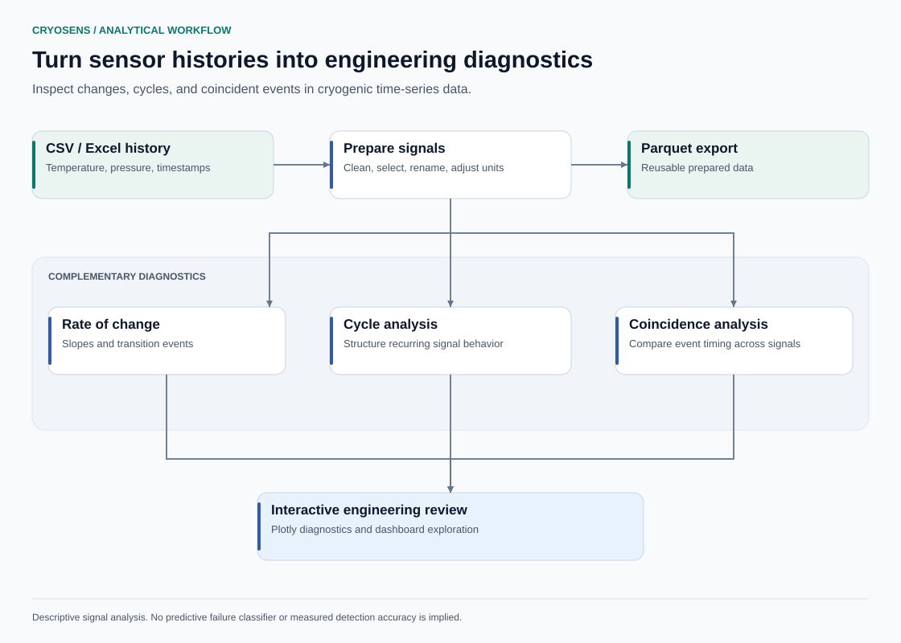

# CryoSens Analytics

Interactive analysis of temperature, pressure, and differential-pressure sensor histories for industrial equipment.

CryoSens makes rapid variations and operating cycles inspectable through reusable Python functions and notebook dashboards. Engineers can adjust thresholds, compare sensors, examine event coincidence, and export prepared data.

## Analysis workflow



[Diagram source](docs/visuals/visual_spec.json)

| Analysis | Purpose |
| --- | --- |
| Rate of change | Identify rapid signal variations |
| Threshold sensitivity | Examine how detected events change with settings |
| Operating cycles | Characterize heating and cooling behavior |
| Event coincidence | Compare event timing across sensors |
| Interactive plots | Inspect signals and selected events in context |

Event thresholds require equipment-specific interpretation. The toolkit characterizes signals and supports engineering review; it does not estimate a validated equipment-failure probability.

## Quick start

Requires Python 3.10+ and uv.

```bash
uv sync --extra dev
uv run python examples/quickstart.py
uv run jupyter notebook notebooks/main.ipynb
```

The [synthetic sample](examples/sample_sensor_data.csv) exercises the loading workflow without customer measurements.

Load your own export:

```python
from cryosens.io.loader import load_data

sensor_data = load_data("measurements.csv")
```

Use the [guided notebook](notebooks/main.ipynb) for preprocessing and interactive analysis. The [user guide](user_guide.pdf) covers the analyst workflow.

## Package structure

| Module | Responsibility |
| --- | --- |
| `io.loader` | CSV and Excel loading |
| `preprocessing.cleaning` | Signal selection, missing values, renaming, unit preparation |
| `analysis.roc` | Rapid variations, sensitivity, and event coincidence |
| `analysis.cycle` | Cycle detection and summaries |
| `visualisation` | Interactive plots and notebook interfaces |
| `save_load` | Parquet persistence |
| `api` | Guided-workflow entry points |

## Verify

```bash
uv sync --extra dev
uv run pytest -q
```

The committed tests cover loading, unit labels, and Parquet persistence. Signal events and cycles should be reviewed with the relevant equipment context.
